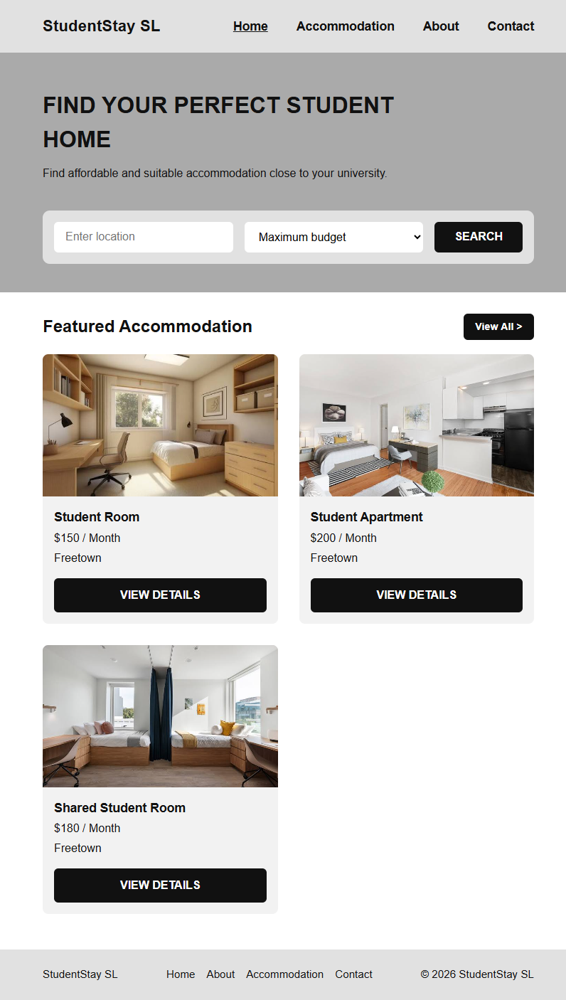
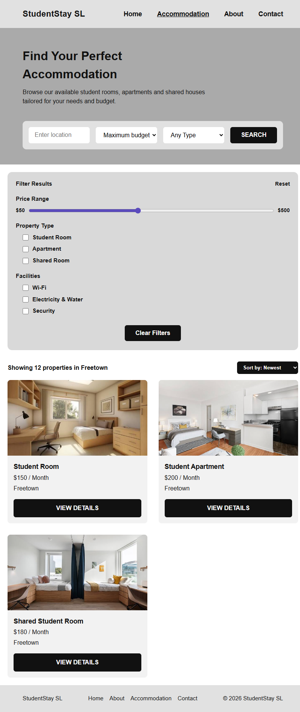
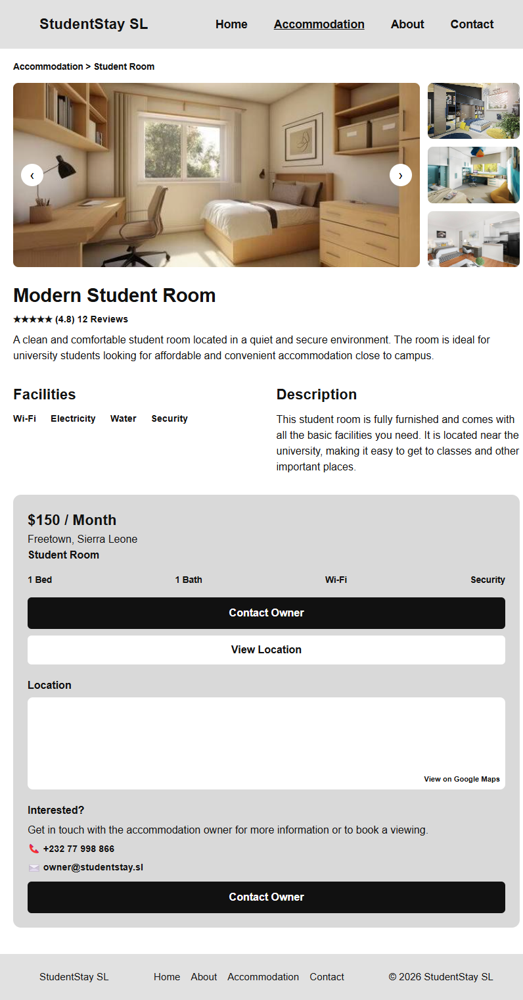
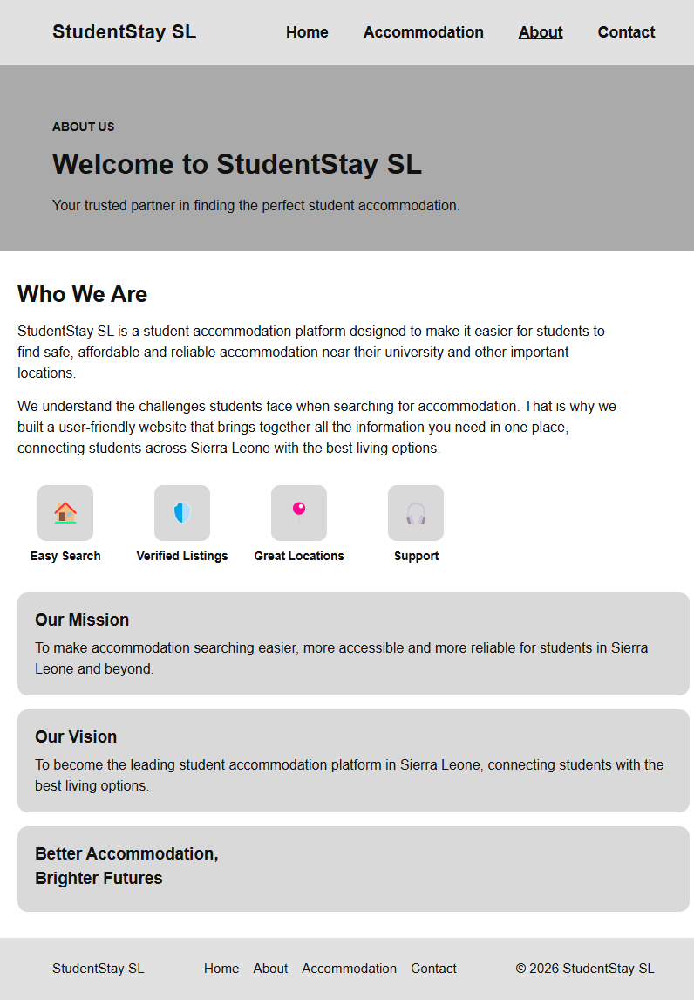
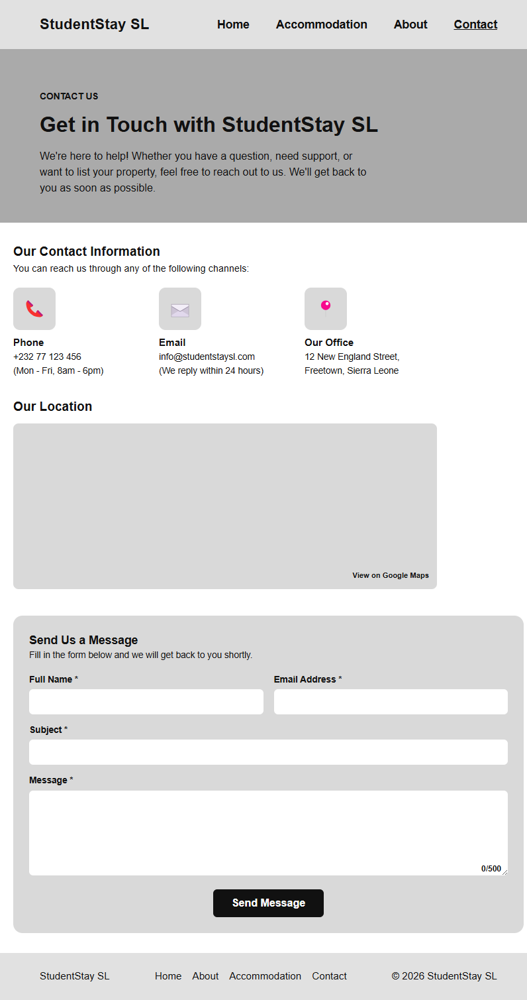
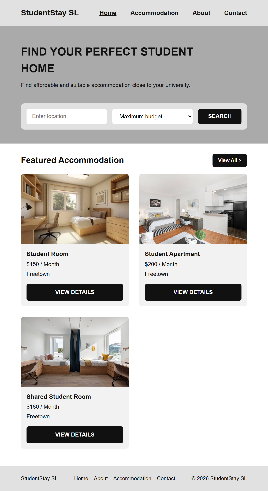

# StudentStay SL

StudentStay SL is a responsive, multi-page student accommodation website for students in Freetown, Sierra Leone. It helps students search for rooms, compare options, view property details and contact owners.

## Project Overview

The website was built for the DCOMP 204 Web Design module (Assignment 2: HTML, CSS and Responsive Website). It turns the Assignment 1 design (research, sitemap, wireframes and Figma prototype) into a working website with five pages.

## Problem Statement

Students looking for accommodation often rely on friends, social media posts and physical searches. Information can be incomplete, outdated or hard to compare, and it takes time to find prices, facilities and contact details.

## Proposed Solution

StudentStay SL brings accommodation information together in one place. Students can search by location and budget, browse property cards, filter results, view photographs, facilities and location details, and contact the owner.

## Target Users

- University students looking for affordable accommodation near campus
- New students who do not know the area
- Students who want to compare several properties
- Accommodation owners and agents (secondary users)

## Pages

| Page | File | Purpose |
|---|---|---|
| Home | index.html | Search bar and featured accommodation |
| Accommodation | accommodation.html | Filters and list of properties |
| Details | details.html | Photos, price, facilities, location and contact options |
| About | about.html | About the platform, mission and vision |
| Contact | contact.html | Contact information and message form |

## Technologies Used

- HTML5 for page structure and semantic tags
- CSS3 for styling, with Flexbox, Grid and media queries for responsive layouts
- JavaScript for the message character counter on the Contact page
- Figma for the Assignment 1 design and prototype
- Visual Studio Code, Git and GitHub

## Project Structure

```
studentstay-sl/
├── css/
│   └── style.css
├── images/
│   └── property photographs
├── screenshots/
│   └── website screenshots
├── index.html
├── accommodation.html
├── details.html
├── about.html
├── contact.html
└── README.md
```

## Responsive Design

The layout adapts to three screen sizes using CSS media queries:

- **Desktop:** full layout with the filter panel beside the property cards
- **Tablet (up to 900px):** two-column cards, with side panels moved below the main content
- **Mobile (up to 600px):** single-column layout and a stacked menu

## How to Run the Website

1. Download or clone this repository from GitHub.
2. Open the project folder in Visual Studio Code.
3. Open `index.html` in a web browser such as Google Chrome. You can also use the Live Server extension.

## Demonstration Notes

StudentStay SL is a front-end project. The search bar, filters and contact form show the intended user experience, but they are not connected to a database and do not send messages or store data.

## Website Screenshots

### Home Page


### Accommodation Page


### Details Page


### About Page


### Contact Page


### Responsive Views (Home Page)

**Ipad-Mini**



**Mobile**


Technologies Used

* HTML5 - Used to structure the website pages and organize content.
* CSS3 - Used for styling, layouts, colours, typography, and responsive design.
* Figma - Used to create the initial design, wireframes, and prototype for Assignment 1.
* Visual Studio Code - Used to write and edit the website code.
* Git and GitHub - Used for version control and managing the project repository.
* Google Chrome - Used to view and test the website.


## Design

The design uses a clean grey palette with dark buttons, clear headings and property photographs. Navigation is consistent across all pages so students can find information quickly.

## Author

Edwina Nicol